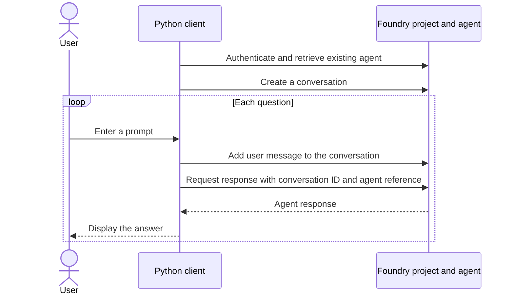
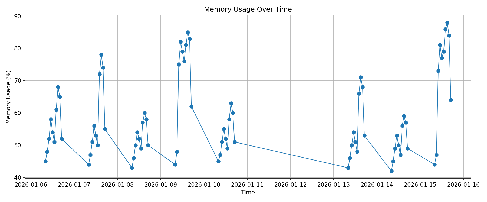
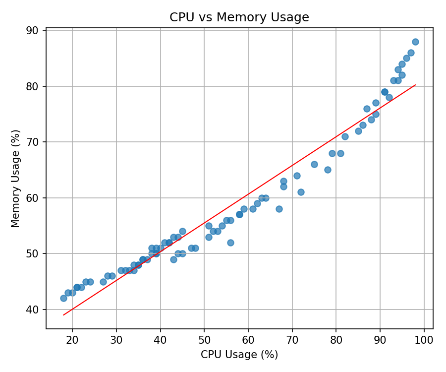

# Lab 6 - Test a Foundry agent in VS Code and Python

[Official lab](https://microsoftlearning.github.io/mslearn-ai-agents/Instructions/Exercises/01-build-agent-portal-and-vscode.html) | [Agent labs](../README.md) | [Repository setup](../../README.md)

An agent combines a model with instructions and any knowledge or tools configured for it. This walkthrough uses the existing agent and project configured in this lab's `.env`. The guide's policy and analysis exercises require IT-support instructions, File search over `IT_Policy.txt`, and Code interpreter with `system_performance.csv` attached. It starts at the guide's **Test your agent in VS Code** stage; creating the project and agent is not repeated here.

First, you will test that agent in the Foundry Toolkit playground. Then [agent_with_functions.py](agent_with_functions.py) connects to it from Python, starts a conversation, and displays answers.

Despite the filename, this client does not define custom function tools, create an agent, upload knowledge, or configure hosted tools. Use your actual configured agent name rather than assuming it matches the guide's example.

## Table of contents

- [1. Test the existing agent in VS Code](#1-test-the-existing-agent-in-vs-code)
- [2. Configure the Python client](#2-configure-the-python-client)
- [3. Install dependencies separately](#3-install-dependencies-separately)
- [4. Run the guide's client prompts](#4-run-the-guides-client-prompts)
- [How the client works](#how-the-client-works)
- [Troubleshooting, privacy, and cleanup](#troubleshooting-privacy-and-cleanup)
- [Validation and conclusion](#validation-and-conclusion)
- [Captured output](#captured-output)
  - [1. Configuration and authentication precheck](#1-configuration-and-authentication-precheck)
  - [2. Install command and setup exit](#2-install-command-and-setup-exit)
  - [3. Guide's five-question client session](#3-guides-five-question-client-session)
    - [3.1. Startup and blank input](#31-startup-and-blank-input)
    - [3.2. Password reset policy](#32-password-reset-policy)
    - [3.3. Memory usage line chart](#33-memory-usage-line-chart)
    - [3.4. Disk usage statistics](#34-disk-usage-statistics)
    - [3.5. CPU and memory correlation](#35-cpu-and-memory-correlation)
    - [3.6. Exit](#36-exit)
  - [4. Additional client run - CPU analysis and playground question](#4-additional-client-run---cpu-analysis-and-playground-question)
    - [4.1. Startup](#41-startup)
    - [4.2. CPU calculation with the filename supplied](#42-cpu-calculation-with-the-filename-supplied)
    - [4.3. Lost-or-stolen-device policy question](#43-lost-or-stolen-device-policy-question)
    - [4.4. Exit](#44-exit)

## 1. Test the existing agent in VS Code

If needed, open **Extensions** with **Ctrl+Shift+X**, install Microsoft's **Foundry Toolkit for VS Code**, then select its sidebar icon and sign in. Some extension labels may still say **AI Toolkit**.

1. Under **Microsoft Foundry Resources**, choose **Set Default Project** and select the project identified by this lab's `PROJECT_ENDPOINT`. If another project is already selected, use the project-selection icon to switch.
2. Expand the project and then **Prompt Agents**. Select the agent named by `AGENT_NAME` to open its Agent Builder playground.
3. In the **playground chat pane**, enter the guide's question:

   ```text
   What is the policy for reporting a lost or stolen device?
   ```

4. Review the answer against the agent's uploaded IT policy. If the document does not cover the question, the agent should acknowledge that gap rather than invent a policy. Use any displayed citations or tool details to inspect the supporting information.

This is a test inside the extension, not a PowerShell command or a run of the Python script. A plausible answer alone does not prove File search ran. If the agent is missing, check the selected project and permissions; do not create a duplicate agent.

## 2. Configure the Python client

Copy the project endpoint by right-clicking the active project in Foundry Toolkit and choosing **Copy Endpoint**. If that option is unavailable, copy the **project endpoint** from the project overview in the Foundry portal. Your signed-in identity needs permission to retrieve and invoke the agent; analysis and generated-file requests also depend on its configured tools and model.

Run the following in **PowerShell from the repository root**. Keep a working `.env`; create one from [.env.example](.env.example) only if it is missing:

```powershell
if (-not (Test-Path .\2_Develop_AI_Agents_with_Azure\06-buildaiagents\.env)) {
    Copy-Item .\2_Develop_AI_Agents_with_Azure\06-buildaiagents\.env.example .\2_Develop_AI_Agents_with_Azure\06-buildaiagents\.env
}
az login
```

Open this lab's `.env` and replace its placeholders:

| Variable | Meaning |
|---|---|
| `PROJECT_ENDPOINT` | The full project URL: `https://<resource>.services.ai.azure.com/api/projects/<project>`. This client needs the project endpoint, not the resource's `/openai/v1/` URL used in the earlier model-only labs. |
| `AGENT_NAME` | The actual name of your existing IT-support agent. Do not enter the project name or a model deployment name. |

Set `AGENT_NAME` explicitly so the Python client and Toolkit playground use the same existing agent. Do not rely on the script's fallback name matching your environment.

## 3. Install dependencies separately

After configuring access, run:

```powershell
.\run-lab.ps1 .\2_Develop_AI_Agents_with_Azure\06-buildaiagents\ agent_with_functions.py -Install
```

**The launcher installs packages and then starts the client.** It retrieves the agent and creates a conversation before showing `You:`. Enter `quit` and press Enter to finish this setup step. Wait for `Goodbye!` and the PowerShell prompt before continuing.

Entering only `quit` sends no model question, but the conversation has already been created in Foundry. The script does not delete it on exit. [requirements.txt](requirements.txt) defines the dependencies and keeps `openai<3` for compatibility with the project SDK's HTTP dependency.

## 4. Run the guide's client prompts

Launch a new session without reinstalling:

```powershell
.\run-lab.ps1 .\2_Develop_AI_Agents_with_Azure\06-buildaiagents\ agent_with_functions.py
```

Look for `Connecting to Microsoft Foundry project...`, `Loading agent:`, `Connected to agent:`, and `Conversation created`. Confirm that the printed agent name matches `AGENT_NAME` and the agent you tested in the Toolkit playground.

When `You:` appears, enter these inputs **one at a time inside the client, not in PowerShell**. Press Enter after each input and wait for the answer and the next `You:` prompt.

| Step | Input or action | What to review |
|---|---|---|
| 1 | Press Enter without typing anything. | The client shows another input prompt without sending a model request. |
| 2 | `What's the policy for password resets?` | Compare the answer with `IT_Policy.txt`. Do not assume a fluent answer proves it retrieved that document. |
| 3 | `Analyze the system performance data and identify any periods where CPU usage exceeded 80%` | Check the reported periods against `system_performance.csv`. This analyzes simulated data, not live system monitoring. |
| 4 | `Create a line chart showing memory usage trends over time` | Review any actual chart returned and check its labels and data. A text description alone does not confirm that a chart was generated. |
| 5 | `What are the average, minimum, and maximum values for disk usage in the performance data?` | Check all three statistics against the source data. |
| 6 | `Find any correlation between high CPU usage and memory usage in the performance data` | Review the calculations and interpretation. Correlation alone does not establish a cause. |
| 7 | `exit` | `Goodbye!` appears and control returns to PowerShell. `quit` and `bye` also work, regardless of capitalization. |

These are the guide's five client tests, with a blank-input check added. The script prints `[Agent is thinking...]` before requesting each answer. Exact wording varies; inspect the agent's available tool evidence and source data rather than rely on the answer alone.

If a policy or data file is unavailable, check the existing agent's File search and Code interpreter attachments before continuing. Typing a prompt does not upload the missing data or enable a tool.

Each question invokes the existing agent and may incur model or hosted-tool charges. Starting the client again creates a new conversation; it does not resume the previous one or the Toolkit playground chat.

## How the client works

The client uses `AIProjectClient` to connect to the project and obtain an OpenAI-compatible client. `DefaultAzureCredential` authenticates those calls, commonly using your Azure CLI sign-in during local development.

For each question, it adds a user message to the cloud conversation, then requests a response using that conversation ID and an `agent_reference`. The response request uses an empty `input` because the user message is already stored in the conversation. The agent's configured model, instructions, knowledge, and tools determine the answer.



## Troubleshooting, privacy, and cleanup

- **Missing endpoint:** Configure `PROJECT_ENDPOINT` in this lab's `.env`. The current script prints a message and returns when it is missing; an exit code of 0 alone is not evidence that it connected.
- **`ResourceNotFound: The project does not exist`:** Copy the actual project endpoint from Foundry Toolkit or the portal. Do not build the URL from an agent name or assume that a resource has a project with the same name. The configured project must exist under the resource named in the endpoint.
- **Agent not found or access denied:** Check the project endpoint, exact agent name, Azure sign-in, and permissions. Installing packages does not create the agent or grant access.
- **No useful policy/data answer or chart:** Check the agent's knowledge and hosted tools. This client does not upload the documents, create an analysis tool, or implement custom function calls.
- **A traceback or no answer:** Investigate it before treating the run as successful. The current client does not explicitly check `response.status` or display `response.error`, and authentication/API/download errors can terminate it with a traceback.
- **Ending the chat:** Prefer `quit`, `exit`, or `bye`. A `KeyboardInterrupt` indicates a local interruption, not a successful exit or an agent response.
- **Resources and costs:** The code does not explicitly close its SDK clients/credential or delete the cloud agent/conversation. Review only your own disposable conversations and hosted artifacts for cleanup; do not delete shared agents or projects.
- **Keep data private:** Questions and responses are stored in the cloud conversation. The client does not automatically write a local chat transcript. Avoid sensitive prompts.

## Validation and conclusion

| Evidence | What it establishes |
|---|---|
| Checked-in client | Implements existing-agent lookup, cloud conversation reuse, and response display. |
| Live connection check | The same SDK lookup used by the client retrieved the configured agent successfully after correcting the local project endpoint. No model question was sent during that check. |
| Guide alignment | Includes the Foundry Toolkit project/agent selection and lost-or-stolen-device question, followed by the guide's five Python-client prompts. The local agent name and shared launcher are documented adaptations. |
| Live README runs, November 14, 2026 | Setup and two client conversations exited normally. The five guide questions, blank input, CPU clarification, and lost-or-stolen-device question were exercised; see the captured output below. |
| Source and artifact checks | Both attached performance CSVs contain the same 80 rows. CPU ranges, disk statistics, and Spearman correlation matched independent calculations; the Pearson rounding discrepancy is recorded below. The memory chart and CPU/memory scatter plot were downloaded and visually inspected. |
| Limits | The new runs did not test the Toolkit playground UI, create/configure an agent, submit a ticket, or change shared resources. Console answers alone do not establish File search execution. Agent creation and tool configuration remain prerequisites. |

**Conclusion:** This lab connects an application to an existing agent and reuses a conversation across questions. Knowledge and analysis depend on that agent's configuration; a successful connection alone does not verify every capability.

## Captured output

These are actual runs of the commands above, from the repository root, using
the existing configured agent. The setup run and two chat runs all exited with
code `0` and printed `Goodbye!`. They created three separate cloud
conversations, which were left intact; no agent, project, or tool configuration
was changed.

The capture supplied each input only after `You:` appeared and added the input
text to the transcript for readability. The client itself does not echo piped
input. Agent/conversation/upload identifiers, the package-index URL, and the
absolute repository path are replaced with placeholders. Unicode punctuation
is normalized to ASCII; answer wording and numerical results are otherwise
preserved. These are historical results, not promises of identical answers on
future runs.

### 1. Configuration and authentication precheck

The conditional `.env` copy from section 2 was evaluated; the existing file was
preserved. Azure authentication was already valid, so `az login` was not rerun.
The following read-only check confirmed that an AI-service token was available
without printing its value:

```powershell
az account get-access-token --resource https://ai.azure.com --query expiresOn --output tsv
```

```text
2026-11-14 23:13:04.000000
```

Both `PROJECT_ENDPOINT` and `AGENT_NAME` were present, and the endpoint used
the required HTTPS `/api/projects/` URL shape. No configuration values or
credentials are included here.

### 2. Install command and setup exit

```powershell
.\run-lab.ps1 .\2_Develop_AI_Agents_with_Azure\06-buildaiagents\ agent_with_functions.py -Install
```

Input: `quit` at the first client prompt. All dependencies were already
installed; this command still performed the documented package check and
started the client.

<details>
<summary>Captured setup output, including the dependency check</summary>

```text
Looking in indexes: <package-index>
Requirement already satisfied: azure-ai-projects>=1.0.0 in .\.labenv\Lib\site-packages (from -r <repository-root>\2_Develop_AI_Agents_with_Azure\06-buildaiagents\requirements.txt (line 1)) (2.3.0)
Requirement already satisfied: azure-identity>=1.15.0 in .\.labenv\Lib\site-packages (from -r <repository-root>\2_Develop_AI_Agents_with_Azure\06-buildaiagents\requirements.txt (line 2)) (1.25.3)
Requirement already satisfied: python-dotenv>=1.0.0 in .\.labenv\Lib\site-packages (from -r <repository-root>\2_Develop_AI_Agents_with_Azure\06-buildaiagents\requirements.txt (line 3)) (1.2.3)
Requirement already satisfied: openai<3 in .\.labenv\Lib\site-packages (from -r <repository-root>\2_Develop_AI_Agents_with_Azure\06-buildaiagents\requirements.txt (line 6)) (2.54.0)
Requirement already satisfied: anyio<5,>=3.5.0 in .\.labenv\Lib\site-packages (from openai<3->-r <repository-root>\2_Develop_AI_Agents_with_Azure\06-buildaiagents\requirements.txt (line 6)) (4.15.1)
Requirement already satisfied: distro<2,>=1.7.0 in .\.labenv\Lib\site-packages (from openai<3->-r <repository-root>\2_Develop_AI_Agents_with_Azure\06-buildaiagents\requirements.txt (line 6)) (1.9.0)
Requirement already satisfied: httpx<1,>=0.23.0 in .\.labenv\Lib\site-packages (from openai<3->-r <repository-root>\2_Develop_AI_Agents_with_Azure\06-buildaiagents\requirements.txt (line 6)) (0.28.1)
Requirement already satisfied: jiter<1,>=0.10.0 in .\.labenv\Lib\site-packages (from openai<3->-r <repository-root>\2_Develop_AI_Agents_with_Azure\06-buildaiagents\requirements.txt (line 6)) (0.17.0)
Requirement already satisfied: pydantic<3,>=1.9.0 in .\.labenv\Lib\site-packages (from openai<3->-r <repository-root>\2_Develop_AI_Agents_with_Azure\06-buildaiagents\requirements.txt (line 6)) (2.13.5)
Requirement already satisfied: sniffio in .\.labenv\Lib\site-packages (from openai<3->-r <repository-root>\2_Develop_AI_Agents_with_Azure\06-buildaiagents\requirements.txt (line 6)) (1.3.1)
Requirement already satisfied: tqdm>4 in .\.labenv\Lib\site-packages (from openai<3->-r <repository-root>\2_Develop_AI_Agents_with_Azure\06-buildaiagents\requirements.txt (line 6)) (4.70.1)
Requirement already satisfied: typing-extensions<5,>=4.14 in .\.labenv\Lib\site-packages (from openai<3->-r <repository-root>\2_Develop_AI_Agents_with_Azure\06-buildaiagents\requirements.txt (line 6)) (4.16.0)
Requirement already satisfied: idna>=2.8 in .\.labenv\Lib\site-packages (from anyio<5,>=3.5.0->openai<3->-r <repository-root>\2_Develop_AI_Agents_with_Azure\06-buildaiagents\requirements.txt (line 6)) (3.20)
Requirement already satisfied: certifi in .\.labenv\Lib\site-packages (from httpx<1,>=0.23.0->openai<3->-r <repository-root>\2_Develop_AI_Agents_with_Azure\06-buildaiagents\requirements.txt (line 6)) (2026.7.22)
Requirement already satisfied: httpcore==1.* in .\.labenv\Lib\site-packages (from httpx<1,>=0.23.0->openai<3->-r <repository-root>\2_Develop_AI_Agents_with_Azure\06-buildaiagents\requirements.txt (line 6)) (1.0.9)
Requirement already satisfied: h11>=0.16 in .\.labenv\Lib\site-packages (from httpcore==1.*->httpx<1,>=0.23.0->openai<3->-r <repository-root>\2_Develop_AI_Agents_with_Azure\06-buildaiagents\requirements.txt (line 6)) (0.16.0)
Requirement already satisfied: annotated-types>=0.6.0 in .\.labenv\Lib\site-packages (from pydantic<3,>=1.9.0->openai<3->-r <repository-root>\2_Develop_AI_Agents_with_Azure\06-buildaiagents\requirements.txt (line 6)) (0.8.0)
Requirement already satisfied: pydantic-core==2.46.5 in .\.labenv\Lib\site-packages (from pydantic<3,>=1.9.0->openai<3->-r <repository-root>\2_Develop_AI_Agents_with_Azure\06-buildaiagents\requirements.txt (line 6)) (2.46.5)
Requirement already satisfied: typing-inspection>=0.4.2 in .\.labenv\Lib\site-packages (from pydantic<3,>=1.9.0->openai<3->-r <repository-root>\2_Develop_AI_Agents_with_Azure\06-buildaiagents\requirements.txt (line 6)) (0.4.4)
Requirement already satisfied: isodate>=0.6.1 in .\.labenv\Lib\site-packages (from azure-ai-projects>=1.0.0->-r <repository-root>\2_Develop_AI_Agents_with_Azure\06-buildaiagents\requirements.txt (line 1)) (0.7.2)
Requirement already satisfied: azure-core>=1.37.0 in .\.labenv\Lib\site-packages (from azure-ai-projects>=1.0.0->-r <repository-root>\2_Develop_AI_Agents_with_Azure\06-buildaiagents\requirements.txt (line 1)) (1.41.0)
Requirement already satisfied: azure-storage-blob>=12.15.0 in .\.labenv\Lib\site-packages (from azure-ai-projects>=1.0.0->-r <repository-root>\2_Develop_AI_Agents_with_Azure\06-buildaiagents\requirements.txt (line 1)) (12.31.0)
Requirement already satisfied: cryptography>=2.5 in .\.labenv\Lib\site-packages (from azure-identity>=1.15.0->-r <repository-root>\2_Develop_AI_Agents_with_Azure\06-buildaiagents\requirements.txt (line 2)) (50.0.1)
Requirement already satisfied: msal>=1.35.1 in .\.labenv\Lib\site-packages (from azure-identity>=1.15.0->-r <repository-root>\2_Develop_AI_Agents_with_Azure\06-buildaiagents\requirements.txt (line 2)) (1.39.0)
Requirement already satisfied: msal-extensions>=1.2.0 in .\.labenv\Lib\site-packages (from azure-identity>=1.15.0->-r <repository-root>\2_Develop_AI_Agents_with_Azure\06-buildaiagents\requirements.txt (line 2)) (1.3.1)
Requirement already satisfied: requests>=2.21.0 in .\.labenv\Lib\site-packages (from azure-core>=1.37.0->azure-ai-projects>=1.0.0->-r <repository-root>\2_Develop_AI_Agents_with_Azure\06-buildaiagents\requirements.txt (line 1)) (2.34.2)
Requirement already satisfied: cffi>=2.0.0 in .\.labenv\Lib\site-packages (from cryptography>=2.5->azure-identity>=1.15.0->-r <repository-root>\2_Develop_AI_Agents_with_Azure\06-buildaiagents\requirements.txt (line 2)) (2.1.1)
Requirement already satisfied: pycparser in .\.labenv\Lib\site-packages (from cffi>=2.0.0->cryptography>=2.5->azure-identity>=1.15.0->-r <repository-root>\2_Develop_AI_Agents_with_Azure\06-buildaiagents\requirements.txt (line 2)) (3.0)
Requirement already satisfied: PyJWT<3,>=1.0.0 in .\.labenv\Lib\site-packages (from PyJWT[crypto]<3,>=1.0.0->msal>=1.35.1->azure-identity>=1.15.0->-r <repository-root>\2_Develop_AI_Agents_with_Azure\06-buildaiagents\requirements.txt (line 2)) (2.15.0)
Requirement already satisfied: charset_normalizer<4,>=2 in .\.labenv\Lib\site-packages (from requests>=2.21.0->azure-core>=1.37.0->azure-ai-projects>=1.0.0->-r <repository-root>\2_Develop_AI_Agents_with_Azure\06-buildaiagents\requirements.txt (line 1)) (3.5.1)
Requirement already satisfied: urllib3<3,>=1.26 in .\.labenv\Lib\site-packages (from requests>=2.21.0->azure-core>=1.37.0->azure-ai-projects>=1.0.0->-r <repository-root>\2_Develop_AI_Agents_with_Azure\06-buildaiagents\requirements.txt (line 1)) (2.8.0)
Requirement already satisfied: colorama in .\.labenv\Lib\site-packages (from tqdm>4->openai<3->-r <repository-root>\2_Develop_AI_Agents_with_Azure\06-buildaiagents\requirements.txt (line 6)) (0.4.6)

[notice] A new release of pip is available: 26.2.1 -> 26.3
[notice] To update, run: python.exe -m pip install --upgrade pip
Connecting to Microsoft Foundry project...
Loading agent: <configured-agent>
Connected to agent: <configured-agent>
Conversation created (id: <conversation-id>)

============================================================
IT Support Agent Ready!
Ask questions, request data analysis, or get help.
Type 'exit' to quit.
============================================================

You: quit
Goodbye!
```

</details>

The pip upgrade notice was not acted on. No model question was sent during
this setup run.

### 3. Guide's five-question client session

```powershell
.\run-lab.ps1 .\2_Develop_AI_Agents_with_Azure\06-buildaiagents\ agent_with_functions.py
```

All five questions below used the same conversation.

#### 3.1. Startup and blank input

```text
Connecting to Microsoft Foundry project...
Loading agent: <configured-agent>
Connected to agent: <configured-agent>
Conversation created (id: <conversation-id>)

============================================================
IT Support Agent Ready!
Ask questions, request data analysis, or get help.
Type 'exit' to quit.
============================================================

You:
```

Pressing Enter without text immediately produced the next `You:` prompt. No
`[Agent is thinking...]` or agent answer appeared for that blank input.

#### 3.2. Password reset policy

```text
You: What's the policy for password resets?

[Agent is thinking...]

Agent: Here's the Contoso policy for password resets and what to expect:

- How to request a reset: submit via the IT Support portal or call the IT helpdesk.
- Identity verification: you'll be asked for your employee ID and to answer security questions.
- Turnaround time: resets are typically completed within 15 minutes during business hours.
- Temporary password: you'll receive a temporary password by SMS or email and must change it at first login.
- Password rules: new passwords must be at least 12 characters, include upper/lowercase letters, numbers, and special characters, and cannot reuse the last 5 passwords.
- Self-service: you can reset via the self-service portal (https://password.contoso.com) if you previously enrolled in MFA.
- Locked accounts / failed attempts: accounts lock after 5 failed logins; self-service unlock is available at https://unlock.contoso.com or IT can unlock immediately.
- After-hours / emergencies: call +1-800-555-HELP for after-hours emergency resets; critical access should be escalated via your manager.

If you'd like, I can start a password-reset ticket for you - I'll need your name, employee ID, location/office, and the best contact number.
```

The reset, password-complexity, account-lock, and emergency details match the
uploaded sample policy. The client did not display a File search citation or
tool trace, so this wording alone does not prove retrieval. The ticket offer
is generated text: the configured tools are File search and Code interpreter,
not a ticket-submission tool. No personal details were supplied and no ticket
was created.

The CPU question was also asked in this session but is omitted from this
excerpt. Section 4.2 shows a separate run with the filename supplied.

#### 3.3. Memory usage line chart

```text
You: Create a line chart showing memory usage trends over time

[Agent is thinking...]

Agent: I created the line chart of memory usage over time and saved it here: [Download the chart](memory_usage_trend.png (saved to agent_outputs\memory_usage_trend.png))

Details:
- File used: /mnt/data/<uploaded-file-id>-system_performance.csv
- Time column: timestamp
- Memory column: memory_percent
- Rows read: 80

If you want any changes (different time range, smoothing, annotations for peaks, or a CSV of the extracted series), tell me what you'd like and I'll update it.
```

The downloaded [memory usage chart](agent_outputs/memory_usage_trend.png) is
104,268 bytes. It plots time against memory usage (%) and was visually
inspected; this was an actual generated PNG, not just a chart description.
Lines connect the recorded samples across gaps, including overnight/weekend
gaps; they do not establish measurements at every intermediate time.



#### 3.4. Disk usage statistics

```text
You: What are the average, minimum, and maximum values for disk usage in the performance data?

[Agent is thinking...]

Agent: Here are the disk usage statistics from the performance data (disk_percent):

- Average: 66.56%
- Minimum: 62%
- Maximum: 72%
- Samples counted: 80

If you want these rounded differently, broken down by time range, or exported to a CSV, I can do that next.
```

Independent calculation over the uploaded CSV gave average `66.5625%`,
minimum `62%`, and maximum `72%` over 80 rows, matching the displayed results
at their stated precision.

#### 3.5. CPU and memory correlation

```text
You: Find any correlation between high CPU usage and memory usage in the performance data

[Agent is thinking...]

Agent: cfile_6af92278b15c819081a5cf4648010c6c.png (saved to agent_outputs\cfile_6af92278b15c819081a5cf4648010c6c.png)I analyzed CPU vs. memory usage in the performance data.

Results:
- Pearson correlation (linear): 0.9743 (strong positive)
- Spearman correlation (rank): 0.9893 (strong monotonic)
- Samples used: 80

Interpretation: CPU and memory usage are very strongly positively correlated in this dataset - higher CPU usage is closely associated with higher memory usage.

I also saved a scatter plot with a linear trendline here: [Download scatter plot](cpu_memory_scatter.png (saved to agent_outputs\cpu_memory_scatter.png))

If you want, I can:
- Compute correlation for specific time windows (e.g., per day or business hours)
- Fit and report a regression equation and R-squared
- Highlight periods where both CPU and memory exceed thresholds (e.g., >80%)
```

The generated [CPU/memory scatter plot](agent_outputs/cpu_memory_scatter.png)
is 65,940 bytes and was visually inspected. The response also downloaded an
[additional generated PNG](agent_outputs/cfile_6af92278b15c819081a5cf4648010c6c.png)
of 36,517 bytes. The missing space after that filename is preserved from the
actual client output.

Independent calculation across all 80 rows gave Pearson `0.974247` and
Spearman `0.989303`. Spearman rounds to the reported `0.9893`, but Pearson
rounds to `0.9742`, not the agent's `0.9743`. The strong-positive interpretation
is consistent with the data; the final Pearson digit is not. These are
whole-dataset correlations, not a calculation limited to CPU-above-80% rows,
and they do not demonstrate causation.



#### 3.6. Exit

```text
You: exit
Goodbye!
```

The launcher returned exit code `0`.

### 4. Additional client run - CPU analysis and playground question

The same command was launched again, creating a new conversation:

```powershell
.\run-lab.ps1 .\2_Develop_AI_Agents_with_Azure\06-buildaiagents\ agent_with_functions.py
```

This run supplied the filename for the CPU analysis and exercised section 1's
lost-or-stolen-device question through Python. It did **not** operate or
validate the Foundry Toolkit playground UI.

#### 4.1. Startup

```text
Connecting to Microsoft Foundry project...
Loading agent: <configured-agent>
Connected to agent: <configured-agent>
Conversation created (id: <conversation-id>)

============================================================
IT Support Agent Ready!
Ask questions, request data analysis, or get help.
Type 'exit' to quit.
============================================================
```

#### 4.2. CPU calculation with the filename supplied

```text
You: Analyze the uploaded system_performance.csv file. Auto-detect the time column and report a brief list of timestamp ranges where CPU usage exceeded 80%. Do not create a CSV or plot.

[Agent is thinking...]

Agent: I inspected the uploaded file and auto-detected the time column named "timestamp". CPU usage > 80% occurred in the following timestamp ranges (inclusive):

- 2026-01-06 15:00:00 - 2026-01-06 15:00:00
- 2026-01-07 14:00:00 - 2026-01-07 16:00:00
- 2026-01-09 10:00:00 - 2026-01-09 16:00:00
- 2026-01-13 15:00:00 - 2026-01-13 15:00:00
- 2026-01-15 10:00:00 - 2026-01-15 16:00:00

If you want, I can (a) return the exact rows that exceeded 80%, (b) collapse adjacent ranges based on a time gap threshold, or (c) create a brief summary of memory/disk/network during those high-CPU periods. Which would you prefer?
```

These five ranges match independent filtering with the strict condition
`cpu_percent > 80`. There are 19 matching samples. Range endpoints describe
consecutive recorded samples, not proof of continuous utilization between
measurements. Both identically named performance attachments were retrieved
read-only and found to have identical content.

#### 4.3. Lost-or-stolen-device policy question

```text
You: What is the policy for reporting a lost or stolen device?

[Agent is thinking...]

Agent: Report it immediately to IT Security and IT Helpdesk. Per the IT policy, lost or stolen company devices must be reported right away so IT can take protective action (remote wipe, suspend access) and record the incident. Specifically:

- Report the loss/theft immediately to IT Security (and your manager) so they can initiate a remote wipe and other containment steps.
- Submit a ticket through the IT Support portal with device details (device type, serial number, last known location/time, user name/employee ID, contact phone/email). Follow the ticket guidelines in the policy.
- If urgent or after hours, call the IT Helpdesk at +1-800-555-HELP (4357) in addition to submitting the portal ticket.

If you'd like, I can create the ticket for you - I'll need your name, employee ID, device type and serial number, last known location/time, and a contact phone/email.
```

The uploaded sample policy explicitly requires immediate reporting of
lost/stolen devices to IT Security and mentions remote-wipe capability.
The answer also adds operational details; those should not be treated as
verified policy requirements merely because the agent states them. No
personal information was supplied, ticket submitted, access suspended, or
device wiped.

#### 4.4. Exit

```text
You: exit
Goodbye!
```

The launcher returned exit code `0`.
