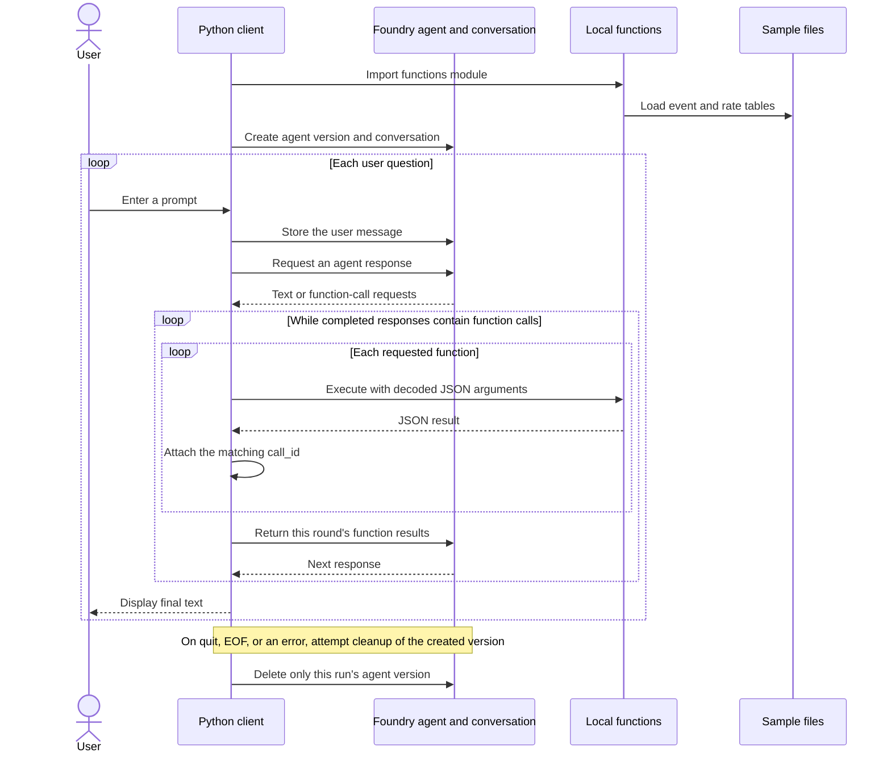

# Lab 7 - Add custom function tools to a Foundry agent

[Agent labs](../README.md) | [Repository setup](../../README.md)

An agent can ask your application to run a function, but the model does not execute that Python code itself. In this lab, [agent.py](agent.py) creates an `astronomy-agent` version with three tool definitions. Your local application handles the requested functions and sends their results back so the agent can write an answer.

[functions.py](functions.py) provides the event lookup, cost calculation, and local report writer. They use the supplied [sample data](data/), not a live astronomy or booking service. No telescope reservation, payment, or email is made.

## Table of contents

- [1. Configure project and model access](#1-configure-project-and-model-access)
- [2. Install dependencies separately](#2-install-dependencies-separately)
- [3. Run the event, cost, and report workflow](#3-run-the-event-cost-and-report-workflow)
- [4. Inspect the report that was actually created](#4-inspect-the-report-that-was-actually-created)
- [How the custom tools work](#how-the-custom-tools-work)
  - [Agent setup and conversation history](#agent-setup-and-conversation-history)
  - [Function arguments and matching results](#function-arguments-and-matching-results)
  - [More than one function call](#more-than-one-function-call)
  - [Interaction flow](#interaction-flow)
- [Troubleshooting, privacy, and cleanup](#troubleshooting-privacy-and-cleanup)
- [Offline checks](#offline-checks)
- [Validation and conclusion](#validation-and-conclusion)
- [Captured output](#captured-output)
  - [1. Configuration and authentication precheck](#1-configuration-and-authentication-precheck)
  - [2. Install command and setup quit](#2-install-command-and-setup-quit)
  - [3. Live event, cost, report, and combined-tools session](#3-live-event-cost-report-and-combined-tools-session)
    - [3.1. Startup and blank input](#31-startup-and-blank-input)
    - [3.2. Next visible sample event](#32-next-visible-sample-event)
    - [3.3. Two standard-telescope hours at normal priority](#33-two-standard-telescope-hours-at-normal-priority)
    - [3.4. Generate the local synthetic observation report](#34-generate-the-local-synthetic-observation-report)
    - [3.5. Optional combined event and cost question](#35-optional-combined-event-and-cost-question)
    - [3.6. Quit and cleanup](#36-quit-and-cleanup)
  - [4. List and inspect the report actually written](#4-list-and-inspect-the-report-actually-written)
  - [5. Offline checks](#5-offline-checks)

## 1. Configure project and model access

Run commands in **PowerShell from the repository root**. Keep an existing working `.env`; create one from [.env.example](.env.example) only if it is missing:

```powershell
if (-not (Test-Path .\2_Develop_AI_Agents_with_Azure\07-customtools\.env)) {
    Copy-Item .\2_Develop_AI_Agents_with_Azure\07-customtools\.env.example .\2_Develop_AI_Agents_with_Azure\07-customtools\.env
}
az login
```

Open this lab's `.env` and set:

| Setting | What to enter |
|---|---|
| `PROJECT_ENDPOINT` | The full existing project URL: `https://<resource>.services.ai.azure.com/api/projects/<project>`. Use the project endpoint, not a model-only `/openai/v1/` URL. |
| `MODEL_DEPLOYMENT_NAME` | The actual name of an existing model deployment in the configured project that supports function calling. |

Your identity needs permission to create, invoke, and delete agent versions. Agent/model calls may incur charges. The agent is created by this client; unlike Lab 6, you do not need to create it in the portal first.

## 2. Install dependencies separately

After configuring access, run:

```powershell
.\run-lab.ps1 .\2_Develop_AI_Agents_with_Azure\07-customtools\ agent.py -Install
```

**The launcher installs packages and then starts the application.** It loads the sample files, creates an agent version and a conversation, and shows `USER:`. Enter `quit` and press Enter to finish this setup step. Wait for the agent-version cleanup messages and the PowerShell prompt before continuing.

No model question is sent if you only enter `quit`, but the cloud agent version and conversation have already been created. The script deletes its created agent version; it does not delete the conversation. [requirements.txt](requirements.txt) defines the SDK dependencies.

## 3. Run the event, cost, and report workflow

Launch a new session without reinstalling:

```powershell
.\run-lab.ps1 .\2_Develop_AI_Agents_with_Azure\07-customtools\ agent.py
```

Follow the `[Data]` messages, then `[1/5]` through `[5/5]`. They show configuration loading, connection, tool definitions, agent-version creation, and conversation setup.

At `USER:`, enter the following **one at a time inside the client, not in PowerShell**. Press Enter after each prompt and wait for `AGENT:` and the next input prompt.

| Step | Input or action | What to look for |
|---|---|---|
| 1 | Press Enter without typing anything. | `No model request was sent.` |
| 2 | `What is the next visible event in north_america?` | `[Tool] Agent requested next_visible_event`, followed by the sample event lookup and its JSON result. |
| 3 | `What does two hours on a standard telescope at normal priority cost?` | `[Tool] Agent requested calculate_observation_cost` and a total of **$125.00**. |
| 4 | `Generate an observation report for event_name "Lab Sample Session", location "north_america", telescope_tier "standard", hours 2, priority "normal", and observer_name "Lab Observer".` | Look for `[Tool] Agent requested generate_observation_report` and its saved filename. In VS Code Explorer, open the newly created `report_lab_sample_session_*.txt` in this lab folder, using the exact filename printed in this turn. Confirm **Observer: Lab Observer**, **Event: Lab Sample Session**, **Location: north_america**, **Tier: standard**, **Hours: 2**, **Priority: normal**, **Base Cost: $100.00**, and **Total Cost: $125.00**. The agent's confirmation alone is not enough. |
| 5 | `quit` | The created agent version is deleted, the SDK clients close, and control returns to PowerShell. |

The cost is a definite calculation from the sample rates: **$50/hour × 2 hours × 1.25 normal-priority multiplier = $125.00**. It is not a current retail-price quote.

The event answer depends on the month/day when you run the client. The function selects the earliest remaining event listed for that continent; it does not search the web or wrap into next year's schedule. A JSON message saying no upcoming events were found is a valid sample-data outcome.

The report prompt explicitly supplies every required argument so the agent need not ask you for missing observer or telescope details. It writes a local file; it does not arrange an observation. Later prompts reuse the same conversation, and the client can handle additional rounds of function requests before displaying the final answer.

The model chooses when to call a tool. If it answers without the corresponding `[Tool]` message, that turn does not demonstrate function execution. Ask it explicitly to call the relevant function and inspect the returned JSON; do not treat a plausible answer alone as a passing tool test.

## 4. Inspect the report that was actually created

After the report tool prints a saved filename, list the local reports:

```powershell
Get-ChildItem -LiteralPath .\2_Develop_AI_Agents_with_Azure\07-customtools -Filter 'report_*.txt' -File
```

Open the exact file named in that turn's `[Report]` message. Check the sample observer, telescope tier, hours, priority, base cost of **$100.00**, and total cost of **$125.00**. A report described only in the agent's answer without a local tool execution/file is not verified.

Reports stay in this lab folder after the agent exits. Their names include the session label and timestamp; repeating the same label within one minute can overwrite its earlier report. Preserve a copy first if needed. Reports are not automatically ignored by Git, so do not commit personal observer details.

## How the custom tools work

### Agent setup and conversation history

At startup, importing [functions.py](functions.py) loads the local event and rate tables. `DefaultAzureCredential` authenticates the project connection, and `AIProjectClient` supplies the client used for conversations and responses.

The application creates an agent version using `PromptAgentDefinition`. Its instructions explain the astronomy-assistant role, while each `FunctionTool` describes a function's name, purpose, and required JSON arguments. These tool schemas use `strict=True` and disallow additional properties. They describe what the agent may request; they do not execute the functions.

For each question:

1. The input loop trims surrounding whitespace. A blank prompt is ignored, and `quit` ends the chat regardless of capitalization.
2. `conversations.items.create` adds the user's message to the existing conversation. This stores the message; it does not generate an answer.
3. `responses.create` asks the agent to process that conversation. `agent_reference` selects the agent by name, and the initial `input=[]` contains no tool results because none have been produced yet.
4. `resolve_tool_calls` checks the response and handles any requested local functions.
5. Once the agent returns final text, the client displays it after `AGENT:`.

Reusing the conversation ID makes earlier messages and results available for follow-up questions. That history is separate from the list of tool results returned for an individual response.

### Function arguments and matching results

Each `function_call` includes the function name, JSON arguments, and a `call_id`. The client accepts only the three functions below. It uses `json.loads()` to turn the arguments into a dictionary, then expands that dictionary into named Python arguments.

For example, this tool argument payload:

```json
{"telescope_tier": "standard", "hours": 2, "priority": "normal"}
```

is passed to the local function as:

```python
calculate_observation_cost(telescope_tier="standard", hours=2, priority="normal")
```

The function returns a JSON string. The application wraps it as a `FunctionCallOutput`, retaining the original `call_id` so the agent knows which request the result answers. All calls in that response are handled before their results are sent back together.

| Function | What it actually does |
|---|---|
| `next_visible_event` | Reads the already loaded sample schedule. It normalizes a location such as `North America` to `north_america` and compares sample month/day values with the current month/day. |
| `calculate_observation_cost` | Checks the telescope tier, hours, and priority, then calculates hourly rate × hours × priority multiplier. Invalid values return an explicit JSON error that the agent can use. |
| `generate_observation_report` | Uses the cost and event functions to build a local text summary, then returns its filename as JSON. This is ordinary local file writing, not a hosted-file download. |

The sample telescope tiers are `standard`, `advanced`, and `premium`. Priorities are `low`, `normal`, `high`, and `urgent`. Event locations come from the sample schedule; check the JSON's `visible_from` field rather than assume every event is visible everywhere.

### More than one function call

In a running session, you can also ask:

```text
Find the next event visible from north_america and calculate two hours of standard telescope time at normal priority.
```

The agent may request the event and cost functions together or in separate rounds. The client returns each round's results on the same conversation and checks the next response again. It does not assume that the first follow-up response must contain the final answer.

A fresh output list is built for each round, so earlier function results are not submitted again. A failed or incomplete response, an unknown function name, or a response with neither function calls nor final text raises an error rather than appearing successful.

### Interaction flow



The model chooses the functions and arguments; the local application executes them. The created agent version is cleaned up in a `finally` block, while the SDK context managers close the clients and credential. The cloud conversation and local reports are not deleted by ordinary client cleanup.

## Troubleshooting, privacy, and cleanup

- **Project not found:** Copy the actual project endpoint from Foundry Toolkit or the portal. An Azure resource name does not prove that a project with the same name exists.
- **Model unavailable or access denied:** Use an actual deployed model name and check the project, sign-in, and agent-management permissions. Installing packages does not provision a model or grant access.
- **Sample files cannot be found:** Use the shared launcher from the repository root. It changes the Python working directory to this lab so the relative `data/...` paths resolve.
- **A function returns an error:** Review its JSON arguments and the explicit `[Cost]` or `[Report]` messages. Correct the inputs rather than interpreting the error as a successful result.
- **The response fails or has no final answer:** The client raises an error instead of printing a success-shaped answer. Unknown function requests are rejected. Agent-version cleanup is attempted even when chat fails.
- **Resources:** Only the agent version created by that run is deleted. Other versions and local reports are not deleted by cleanup. Cloud conversations remain; remove only your own disposable test conversations as appropriate.
- **Privacy:** Prompts are stored in the cloud conversation, and report files can contain observer details. Use the synthetic examples above and keep private reports out of Git.

## Offline checks

After installing the dependencies, run the focused tests from this lab folder:

```powershell
& {
    $ErrorActionPreference = 'Stop'
    $python = Join-Path (Get-Location) '.labenv\Scripts\python.exe'
    Push-Location .\2_Develop_AI_Agents_with_Azure\07-customtools
    try {
        & $python -m unittest test_custom_tools -v
        if ($LASTEXITCODE -ne 0) { throw 'Custom-tools tests failed.' }
    } finally {
        Pop-Location
    }
}
```

**Eight offline tests passed**, covering exact cost results, invalid-input messages, sample event/no-match behavior, actual local report writing, chained function calls and matching call IDs, failed responses, and cleanup of only the created agent version.

## Validation and conclusion

The recorded launcher run passed using the project and deployment configured for that test:

| Check | Observed result |
|---|---|
| Event lookup | The agent requested `next_visible_event`; local Python returned the matching sample event. |
| Cost calculation | The agent requested `calculate_observation_cost`; two standard-telescope hours at normal priority produced **$125.00**. |
| Report generation | The agent requested `generate_observation_report`; the local file contained the synthetic observer and expected **$125.00** total. |
| Quit and cleanup | The launcher returned exit **0** and deleted the agent version created by that run. The validation harness also removed only its own test conversation and synthetic report. Ordinary client runs leave their conversations and reports in place. |

The eight offline tests also passed. Neither these tests nor the live run establishes real astronomical visibility, retail pricing, telescope availability, or successful bookings. Check the `[Tool]`, `[Tool result]`, `[Report]`, and cleanup messages—not just the agent's prose.

**Conclusion:** The agent requests a function; your application executes it and returns the result. This lab demonstrates that round trip with sample astronomy data, deterministic cost calculations, and a local report, not a live observation service or a booking system.

## Captured output

These are actual repository-root runs captured on **November 14, 2026,
22:22:46–22:24:22, local time UTC-05:00**. The setup launcher started at
22:22:46 and the workflow launcher at 22:23:20. Both exited `0`, deleted only
their created agent version, and left their two separate cloud conversations
intact. No runtime source, shared environment, existing report, or `.env` was
changed. The newly generated report is retained below.

Each input was supplied only after the actual `USER:` prompt appeared. Input
text was inserted into the transcript for readability; the piped client does
not echo it itself. Configuration values, conversation identifiers, URLs, and
the absolute repository path are redacted. Agent wording, tool JSON, numeric
results, and filenames are preserved. The synthetic observer and session
names are not personal data.

### 1. Configuration and authentication precheck

The documented conditional `.env` copy was evaluated and produced no output:
the existing file was preserved. Read-only checks confirmed a configured model
and the required HTTPS `/api/projects/` endpoint shape, without printing either
configuration value. Existing Azure authentication was valid, so `az login`
was **not rerun** and no portal or `.env` editing was needed.

The additional read-only token-expiry command was:

```powershell
az account get-access-token --resource https://ai.azure.com --query expiresOn --output tsv
```

```text
2026-11-14 23:29:57.000000
```

Exit status: `0`. No token or account identity was printed.

Before allowing the documented `-Install` command, every direct requirement
and active transitive constraint was checked against the existing `.labenv`.
All were satisfied: `python-dotenv 1.2.3`, `azure-identity 1.25.3`,
`azure-ai-projects 2.3.0` (the exact pin), and `openai 2.54.0` (below 3).
The SDK imports also succeeded. Consequently the install step below only
reported already-satisfied packages; no install, uninstall, or upgrade occurred.

### 2. Install command and setup quit

```powershell
.\run-lab.ps1 .\2_Develop_AI_Agents_with_Azure\07-customtools\ agent.py -Install
```

Input: `quit` at the first `USER:` prompt. Exit status: `0`.
No model question was sent in this setup conversation.

<details>
<summary>Captured dependency check, startup, and setup cleanup</summary>

```text
Looking in indexes: <redacted-url>
Requirement already satisfied: python-dotenv in .\.labenv\Lib\site-packages (from -r <repository-root>\2_Develop_AI_Agents_with_Azure\07-customtools\requirements.txt (line 1)) (1.2.3)
Requirement already satisfied: azure-identity in .\.labenv\Lib\site-packages (from -r <repository-root>\2_Develop_AI_Agents_with_Azure\07-customtools\requirements.txt (line 2)) (1.25.3)
Requirement already satisfied: azure-ai-projects==2.3.0 in .\.labenv\Lib\site-packages (from -r <repository-root>\2_Develop_AI_Agents_with_Azure\07-customtools\requirements.txt (line 3)) (2.3.0)
Requirement already satisfied: openai<3 in .\.labenv\Lib\site-packages (from -r <repository-root>\2_Develop_AI_Agents_with_Azure\07-customtools\requirements.txt (line 6)) (2.54.0)
Requirement already satisfied: isodate>=0.6.1 in .\.labenv\Lib\site-packages (from azure-ai-projects==2.3.0->-r <repository-root>\2_Develop_AI_Agents_with_Azure\07-customtools\requirements.txt (line 3)) (0.7.2)
Requirement already satisfied: azure-core>=1.37.0 in .\.labenv\Lib\site-packages (from azure-ai-projects==2.3.0->-r <repository-root>\2_Develop_AI_Agents_with_Azure\07-customtools\requirements.txt (line 3)) (1.41.0)
Requirement already satisfied: typing-extensions>=4.11 in .\.labenv\Lib\site-packages (from azure-ai-projects==2.3.0->-r <repository-root>\2_Develop_AI_Agents_with_Azure\07-customtools\requirements.txt (line 3)) (4.16.0)
Requirement already satisfied: azure-storage-blob>=12.15.0 in .\.labenv\Lib\site-packages (from azure-ai-projects==2.3.0->-r <repository-root>\2_Develop_AI_Agents_with_Azure\07-customtools\requirements.txt (line 3)) (12.31.0)
Requirement already satisfied: anyio<5,>=3.5.0 in .\.labenv\Lib\site-packages (from openai<3->-r <repository-root>\2_Develop_AI_Agents_with_Azure\07-customtools\requirements.txt (line 6)) (4.15.1)
Requirement already satisfied: distro<2,>=1.7.0 in .\.labenv\Lib\site-packages (from openai<3->-r <repository-root>\2_Develop_AI_Agents_with_Azure\07-customtools\requirements.txt (line 6)) (1.9.0)
Requirement already satisfied: httpx<1,>=0.23.0 in .\.labenv\Lib\site-packages (from openai<3->-r <repository-root>\2_Develop_AI_Agents_with_Azure\07-customtools\requirements.txt (line 6)) (0.28.1)
Requirement already satisfied: jiter<1,>=0.10.0 in .\.labenv\Lib\site-packages (from openai<3->-r <repository-root>\2_Develop_AI_Agents_with_Azure\07-customtools\requirements.txt (line 6)) (0.17.0)
Requirement already satisfied: pydantic<3,>=1.9.0 in .\.labenv\Lib\site-packages (from openai<3->-r <repository-root>\2_Develop_AI_Agents_with_Azure\07-customtools\requirements.txt (line 6)) (2.13.5)
Requirement already satisfied: sniffio in .\.labenv\Lib\site-packages (from openai<3->-r <repository-root>\2_Develop_AI_Agents_with_Azure\07-customtools\requirements.txt (line 6)) (1.3.1)
Requirement already satisfied: tqdm>4 in .\.labenv\Lib\site-packages (from openai<3->-r <repository-root>\2_Develop_AI_Agents_with_Azure\07-customtools\requirements.txt (line 6)) (4.70.1)
Requirement already satisfied: idna>=2.8 in .\.labenv\Lib\site-packages (from anyio<5,>=3.5.0->openai<3->-r <repository-root>\2_Develop_AI_Agents_with_Azure\07-customtools\requirements.txt (line 6)) (3.20)
Requirement already satisfied: certifi in .\.labenv\Lib\site-packages (from httpx<1,>=0.23.0->openai<3->-r <repository-root>\2_Develop_AI_Agents_with_Azure\07-customtools\requirements.txt (line 6)) (2026.7.22)
Requirement already satisfied: httpcore==1.* in .\.labenv\Lib\site-packages (from httpx<1,>=0.23.0->openai<3->-r <repository-root>\2_Develop_AI_Agents_with_Azure\07-customtools\requirements.txt (line 6)) (1.0.9)
Requirement already satisfied: h11>=0.16 in .\.labenv\Lib\site-packages (from httpcore==1.*->httpx<1,>=0.23.0->openai<3->-r <repository-root>\2_Develop_AI_Agents_with_Azure\07-customtools\requirements.txt (line 6)) (0.16.0)
Requirement already satisfied: annotated-types>=0.6.0 in .\.labenv\Lib\site-packages (from pydantic<3,>=1.9.0->openai<3->-r <repository-root>\2_Develop_AI_Agents_with_Azure\07-customtools\requirements.txt (line 6)) (0.8.0)
Requirement already satisfied: pydantic-core==2.46.5 in .\.labenv\Lib\site-packages (from pydantic<3,>=1.9.0->openai<3->-r <repository-root>\2_Develop_AI_Agents_with_Azure\07-customtools\requirements.txt (line 6)) (2.46.5)
Requirement already satisfied: typing-inspection>=0.4.2 in .\.labenv\Lib\site-packages (from pydantic<3,>=1.9.0->openai<3->-r <repository-root>\2_Develop_AI_Agents_with_Azure\07-customtools\requirements.txt (line 6)) (0.4.4)
Requirement already satisfied: cryptography>=2.5 in .\.labenv\Lib\site-packages (from azure-identity->-r <repository-root>\2_Develop_AI_Agents_with_Azure\07-customtools\requirements.txt (line 2)) (50.0.1)
Requirement already satisfied: msal>=1.35.1 in .\.labenv\Lib\site-packages (from azure-identity->-r <repository-root>\2_Develop_AI_Agents_with_Azure\07-customtools\requirements.txt (line 2)) (1.39.0)
Requirement already satisfied: msal-extensions>=1.2.0 in .\.labenv\Lib\site-packages (from azure-identity->-r <repository-root>\2_Develop_AI_Agents_with_Azure\07-customtools\requirements.txt (line 2)) (1.3.1)
Requirement already satisfied: requests>=2.21.0 in .\.labenv\Lib\site-packages (from azure-core>=1.37.0->azure-ai-projects==2.3.0->-r <repository-root>\2_Develop_AI_Agents_with_Azure\07-customtools\requirements.txt (line 3)) (2.34.2)
Requirement already satisfied: cffi>=2.0.0 in .\.labenv\Lib\site-packages (from cryptography>=2.5->azure-identity->-r <repository-root>\2_Develop_AI_Agents_with_Azure\07-customtools\requirements.txt (line 2)) (2.1.1)
Requirement already satisfied: pycparser in .\.labenv\Lib\site-packages (from cffi>=2.0.0->cryptography>=2.5->azure-identity->-r <repository-root>\2_Develop_AI_Agents_with_Azure\07-customtools\requirements.txt (line 2)) (3.0)
Requirement already satisfied: PyJWT<3,>=1.0.0 in .\.labenv\Lib\site-packages (from PyJWT[crypto]<3,>=1.0.0->msal>=1.35.1->azure-identity->-r <repository-root>\2_Develop_AI_Agents_with_Azure\07-customtools\requirements.txt (line 2)) (2.15.0)
Requirement already satisfied: charset_normalizer<4,>=2 in .\.labenv\Lib\site-packages (from requests>=2.21.0->azure-core>=1.37.0->azure-ai-projects==2.3.0->-r <repository-root>\2_Develop_AI_Agents_with_Azure\07-customtools\requirements.txt (line 3)) (3.5.1)
Requirement already satisfied: urllib3<3,>=1.26 in .\.labenv\Lib\site-packages (from requests>=2.21.0->azure-core>=1.37.0->azure-ai-projects==2.3.0->-r <repository-root>\2_Develop_AI_Agents_with_Azure\07-customtools\requirements.txt (line 3)) (2.8.0)
Requirement already satisfied: colorama in .\.labenv\Lib\site-packages (from tqdm>4->openai<3->-r <repository-root>\2_Develop_AI_Agents_with_Azure\07-customtools\requirements.txt (line 6)) (0.4.6)

[notice] A new release of pip is available: 26.2.1 -> 26.3
[notice] To update, run: python.exe -m pip install --upgrade pip
[Data] Loading sample events from data/events.txt...
[Data] Loaded 9 sample events; this is not a live astronomy lookup.
[Data] Loading sample rates from data/telescope_rates.txt...
[Data] Loaded 3 rate entries.
[Data] Loading sample rates from data/priority_multipliers.txt...
[Data] Loaded 4 rate entries.

[1/5] Loading the Foundry project and model deployment configuration...
Selected deployment: <configured-model-deployment-name>
The agent uses local sample data; it does not make bookings, payments, or live astronomy lookups.
Agent creation and model calls may incur charges.

[2/5] Connecting to Foundry with Microsoft Entra authentication...

[3/5] Defining the event, cost, and report function tools...

[4/5] Creating a new astronomy-agent version with those tool definitions...
Created agent version: astronomy-agent / 1

[5/5] Creating a conversation for interactive questions...
Conversation created: <redacted-id>
The same conversation is reused for follow-up questions.
Enter a prompt for the astronomy agent. Use 'quit' to exit.
USER: quit
Exiting chat.
[Cleanup] Deleting only the agent version created by this run: astronomy-agent / 1...
[Cleanup] Created agent version deleted. Existing versions and local reports are preserved.
[Cleanup] Closing the SDK clients and Azure credential. The cloud conversation is not deleted.
[Complete] Astronomy chat ended and agent-version cleanup completed.
```

</details>

The pip upgrade notice is preserved as emitted; its suggested command was
**not executed**. Version `1` appeared in both independent runs because the
setup version was deleted before the workflow version was created; it does
not mean the setup conversation was reused.

### 3. Live event, cost, report, and combined-tools session

```powershell
.\run-lab.ps1 .\2_Develop_AI_Agents_with_Azure\07-customtools\ agent.py
```

Exit status: `0`. The following subsections are consecutive turns in this
run's own conversation. All four nonblank questions received the expected
local `[Tool]` execution messages; no clarification or corrective prompt was
needed. The fourth question is the documented optional combined-tools example.

#### 3.1. Startup and blank input

```text
[Data] Loading sample events from data/events.txt...
[Data] Loaded 9 sample events; this is not a live astronomy lookup.
[Data] Loading sample rates from data/telescope_rates.txt...
[Data] Loaded 3 rate entries.
[Data] Loading sample rates from data/priority_multipliers.txt...
[Data] Loaded 4 rate entries.

[1/5] Loading the Foundry project and model deployment configuration...
Selected deployment: <configured-model-deployment-name>
The agent uses local sample data; it does not make bookings, payments, or live astronomy lookups.
Agent creation and model calls may incur charges.

[2/5] Connecting to Foundry with Microsoft Entra authentication...

[3/5] Defining the event, cost, and report function tools...

[4/5] Creating a new astronomy-agent version with those tool definitions...
Created agent version: astronomy-agent / 1

[5/5] Creating a conversation for interactive questions...
Conversation created: <redacted-id>
The same conversation is reused for follow-up questions.
Enter a prompt for the astronomy agent. Use 'quit' to exit.
USER: 
[Input] Please enter a prompt. No model request was sent.
Enter a prompt for the astronomy agent. Use 'quit' to exit.
```

#### 3.2. Next visible sample event

```text
USER: What is the next visible event in north_america?
[Conversation] Adding your question to the existing conversation...
[Request] Asking the agent to answer or request a function. Waiting for its response...
[Tool] Agent requested next_visible_event; executing it in local Python...
[Event] Searching the sample schedule for north_america, on or after month/day 1114...
[Event] Found Geminids Meteor Shower, sample date 12-14.
[Tool result] {"event": "Geminids Meteor Shower", "type": "meteor_shower", "date": "12-14", "visible_from": ["africa", "asia", "australia", "europe", "north_america", "south_america"]}
[Request] Returning 1 function result(s) to the agent. Waiting for the next response...
AGENT: The next visible event in North America is the **Geminids Meteor Shower** on **December 14**.
Enter a prompt for the astronomy agent. Use 'quit' to exit.
```

This matches the earliest remaining `north_america` entry in `data/events.txt`
on local month/day `1114`. It is a supplied schedule result, not independently
verified sky visibility.

#### 3.3. Two standard-telescope hours at normal priority

```text
USER: What does two hours on a standard telescope at normal priority cost?
[Conversation] Adding your question to the existing conversation...
[Request] Asking the agent to answer or request a function. Waiting for its response...
[Tool] Agent requested calculate_observation_cost; executing it in local Python...
[Cost] Checking tier=standard, hours=2, priority=normal...
[Cost] $50.00/hour x 2 hours x 1.25 priority multiplier = $125.00. No booking or payment is made.
[Tool result] {"telescope_tier": "standard", "hours": 2, "hourly_rate": 50.0, "priority": "normal", "priority_multiplier": 1.25, "base_cost": 100.0, "total_cost": 125.0}
[Request] Returning 1 function result(s) to the agent. Waiting for the next response...
AGENT: Two hours on a **standard** telescope at **normal** priority costs **$125.00**.
Enter a prompt for the astronomy agent. Use 'quit' to exit.
```

The source tables contain `standard|50.00` and `normal|1.25`; the base cost is
`50 × 2 = 100` and the total is `100 × 1.25 = 125`. This is sample pricing.

#### 3.4. Generate the local synthetic observation report

```text
USER: Generate an observation report for event_name "Lab Sample Session", location "north_america", telescope_tier "standard", hours 2, priority "normal", and observer_name "Lab Observer".
[Conversation] Adding your question to the existing conversation...
[Request] Asking the agent to answer or request a function. Waiting for its response...
[Tool] Agent requested generate_observation_report; executing it in local Python...
[Report] Preparing a local observation summary; checking cost and sample event details...
[Cost] Checking tier=standard, hours=2, priority=normal...
[Cost] $50.00/hour x 2 hours x 1.25 priority multiplier = $125.00. No booking or payment is made.
[Event] Searching the sample schedule for north_america, on or after month/day 1114...
[Event] Found Geminids Meteor Shower, sample date 12-14.
[Report] Writing the summary to report_lab_sample_session_2026-11-14_2223.txt...
[Report] Saved report_lab_sample_session_2026-11-14_2223.txt. This is a local report, not an observation booking.
[Tool result] {"status": "Report generated", "file": "report_lab_sample_session_2026-11-14_2223.txt"}
[Request] Returning 1 function result(s) to the agent. Waiting for the next response...
AGENT: Observation report generated successfully.

**File:** `report_lab_sample_session_2026-11-14_2223.txt`
Enter a prompt for the astronomy agent. Use 'quit' to exit.
```

The actual file is linked and inspected in subsection 4 below. The agent's
filename confirmation alone was not used as proof.

#### 3.5. Optional combined event and cost question

```text
USER: Find the next event visible from north_america and calculate two hours of standard telescope time at normal priority.
[Conversation] Adding your question to the existing conversation...
[Request] Asking the agent to answer or request a function. Waiting for its response...
[Tool] Agent requested next_visible_event; executing it in local Python...
[Event] Searching the sample schedule for north_america, on or after month/day 1114...
[Event] Found Geminids Meteor Shower, sample date 12-14.
[Tool result] {"event": "Geminids Meteor Shower", "type": "meteor_shower", "date": "12-14", "visible_from": ["africa", "asia", "australia", "europe", "north_america", "south_america"]}
[Tool] Agent requested calculate_observation_cost; executing it in local Python...
[Cost] Checking tier=standard, hours=2, priority=normal...
[Cost] $50.00/hour x 2 hours x 1.25 priority multiplier = $125.00. No booking or payment is made.
[Tool result] {"telescope_tier": "standard", "hours": 2, "hourly_rate": 50.0, "priority": "normal", "priority_multiplier": 1.25, "base_cost": 100.0, "total_cost": 125.0}
[Request] Returning 2 function result(s) to the agent. Waiting for the next response...
AGENT: The next event visible from **North America** is the **Geminids Meteor Shower** on **December 14**.

Two hours on a **standard** telescope at **normal** priority costs **$125.00**.
Enter a prompt for the astronomy agent. Use 'quit' to exit.
```

Both functions were requested in the same response and their two results were
returned together. This live turn demonstrates a single round with two calls;
the offline test below separately covers chained rounds and matching call IDs.

#### 3.6. Quit and cleanup

```text
USER: quit
Exiting chat.
[Cleanup] Deleting only the agent version created by this run: astronomy-agent / 1...
[Cleanup] Created agent version deleted. Existing versions and local reports are preserved.
[Cleanup] Closing the SDK clients and Azure credential. The cloud conversation is not deleted.
[Complete] Astronomy chat ended and agent-version cleanup completed.
```

The launcher returned `0`. A subsequent read-only SDK `get_version` check for
this run's `astronomy-agent / 1` returned HTTP `404` (`ResourceNotFoundError`),
confirming that cleanup actually removed the created version. Neither test
conversation was deleted.

### 4. List and inspect the report actually written

```powershell
Get-ChildItem -LiteralPath .\2_Develop_AI_Agents_with_Azure\07-customtools -Filter 'report_*.txt' -File
```

Successful command, exit status `0`; only the absolute directory path is
redacted in this formatted listing:

```text
    Directory: <repository-root>\2_Develop_AI_Agents_with_Azure\07-customtools

Mode                 LastWriteTime         Length Name
----                 -------------         ------ ----
-a---          11/14/2026  9:56 PM            581 report_lab_sample_session_2026-11-14_2156.txt
-a---          11/14/2026 10:23 PM            581 report_lab_sample_session_2026-11-14_2223.txt
```

The `2156` file already existed before these runs and was left untouched; it is
not evidence from this capture. The newly written
[report_lab_sample_session_2026-11-14_2223.txt](report_lab_sample_session_2026-11-14_2223.txt)
is **581 bytes** and contains:

```text
======================================
  CONTOSO OBSERVATORIES - SESSION REPORT
======================================
Date:           2026-11-14 22:23
Observer:       Lab Observer
Event:          Lab Sample Session
Location:       north_america

NEXT VISIBLE EVENT
  Event:        Geminids Meteor Shower
  Date:         12-14

TELESCOPE BOOKING
  Tier:         standard
  Hours:        2
  Hourly Rate:  $50.00
  Priority:     normal
  Multiplier:   1.25x

COST SUMMARY
  Base Cost:    $100.00
  Total Cost:   $125.00
======================================
```

All eight required observer/event/location/tier/hours/priority/base-cost/
total-cost fields were checked against the real file and matched the prompt
and sample tables. The VS Code Explorer UI action was **not performed**;
the exact newly generated file was read directly instead. Despite the file's
literal `TELESCOPE BOOKING` heading, this is a **synthetic, draft-only local
report**, not a reservation, payment, email, or live-service confirmation.

### 5. Offline checks

The documented test command was run from the repository root:

```powershell
& {
    $ErrorActionPreference = 'Stop'
    $python = Join-Path (Get-Location) '.labenv\Scripts\python.exe'
    Push-Location .\2_Develop_AI_Agents_with_Azure\07-customtools
    try {
        & $python -m unittest test_custom_tools -v
        if ($LASTEXITCODE -ne 0) { throw 'Custom-tools tests failed.' }
    } finally {
        Pop-Location
    }
}
```

For this process only, `TEMP`, `TMP`, and `TMPDIR` pointed to a private scratch
directory inside this lab so the report-writing test stayed within the owned
scope. The scratch directory was removed afterward. Exit status: `0`.

```text
[Data] Loading sample events from data/events.txt...
[Data] Loaded 9 sample events; this is not a live astronomy lookup.
[Data] Loading sample rates from data/telescope_rates.txt...
[Data] Loaded 3 rate entries.
[Data] Loading sample rates from data/priority_multipliers.txt...
[Data] Loaded 4 rate entries.
test_blank_input_and_quit_do_not_invoke_model_and_delete_only_created_version (test_custom_tools.AgentToolTests.test_blank_input_and_quit_do_not_invoke_model_and_delete_only_created_version) ... ok
test_failed_incomplete_empty_and_unknown_tool_responses_are_errors (test_custom_tools.AgentToolTests.test_failed_incomplete_empty_and_unknown_tool_responses_are_errors) ... ok
test_failed_model_request_still_cleans_up_without_announcing_completion (test_custom_tools.AgentToolTests.test_failed_model_request_still_cleans_up_without_announcing_completion) ... ok
test_multiple_rounds_execute_local_tools_and_return_matching_call_ids (test_custom_tools.AgentToolTests.test_multiple_rounds_execute_local_tools_and_return_matching_call_ids) ... ok
test_cost_explains_the_calculation_and_preserves_result (test_custom_tools.LocalToolTests.test_cost_explains_the_calculation_and_preserves_result) ... ok
test_invalid_cost_inputs_return_explicit_tool_errors (test_custom_tools.LocalToolTests.test_invalid_cost_inputs_return_explicit_tool_errors) ... ok
test_report_writes_real_file_and_reports_its_path (test_custom_tools.LocalToolTests.test_report_writes_real_file_and_reports_its_path) ... ok
test_sample_event_and_no_match_are_both_explained (test_custom_tools.LocalToolTests.test_sample_event_and_no_match_are_both_explained) ... ok

----------------------------------------------------------------------
Ran 8 tests in 0.055s

OK
```

No execution blockers occurred. Blank input sent no model request; every
requested live function executed, the event and cost matched the sample source
data, the report contents were independently verified, and cleanup was checked
beyond a success-shaped exit status. No claims of real astronomy, bookings, or
current commercial prices are established by these outputs.
